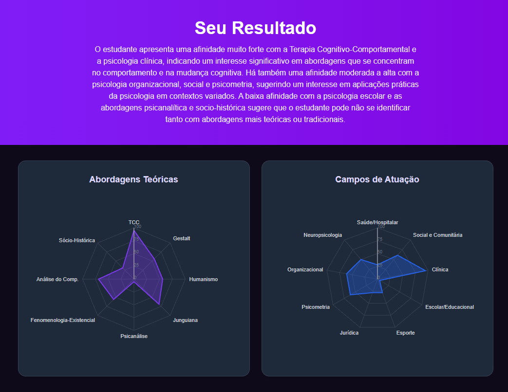

<h1 align="center">João Pedro Lira</h1>

  <b>Fullstack Developer · Go + Next.js</b> 
  Psychology grad turned developer. I build fast Go backends and clean React interfaces. 
  Based in Fortaleza, Brazil · Comfortable working in English and Portuguese

  
  
  

---

### 🧪 Latest build: [PsiEncontra](https://psiencontra.vercel.app)

A self-assessment platform that helps Psychology students find their theoretical approach and field of practice. It's where my two backgrounds meet.

- **Go scoring engine** using ipsative normalization to rank affinities
- **LLM analysis** of open-ended answers to catch what numbers miss
- **Radar charts, Google sign-in and PDF reports** in Next.js

[Try it live →](https://psiencontra.vercel.app) · [Code →](https://github.com/lirajoaop/psiencontra)

### 🧰 Toolbox

